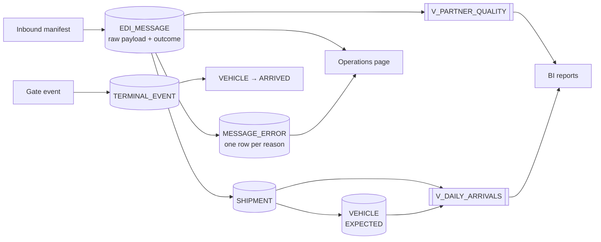

# Data flow

Which data is created where, who reads it, and how long it is kept.
Table definitions: [data model](../database/data-model.md).

| Data | Created by | Read by | Retention | Sensitivity |
|---|---|---|---|---|
| Raw payload (`EDI_MESSAGE.raw_payload`) | PortFlow on receipt | Customer service, second line | 90 days, then purged | Business confidential; no personal data |
| Message outcome and errors | PortFlow | Operations page, reports | 2 years (trend analysis) | Internal |
| Shipments and vehicles | PortFlow (accepted only) | Planners, gate, TOS (phase 3) | Until the vehicle leaves + 1 year | Business confidential |
| Terminal events | Gate | Planners, reports | 2 years | Internal |
| Spooled messages | PortFlow when the database is down | PortFlow worker | Until processed (minutes) | As raw payload |

VINs identify vehicles, not people, so the data set holds no personal data under GDPR as long
as no driver or buyer details are added. If a partner starts sending them, that is a change to
assess (data protection impact) before accepting the field.
