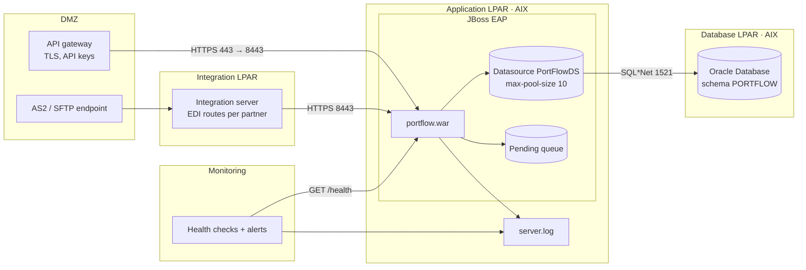

# Deployment view

Target production deployment. Platform background:
[10 · Infrastructure and application server](../docs/10-infrastructure-and-application-server.md).



| Node | Runs | Network |
|---|---|---|
| DMZ | API gateway, AS2/SFTP endpoint | Internet-facing, only 443 / AS2 / SFTP inbound |
| Integration LPAR | Integration server with partner routes | DMZ → integration, integration → application 8443 |
| Application LPAR | JBoss EAP with `portflow.war` | Inbound 8443 from gateway and integration only; outbound 1521 to the database |
| Database LPAR | Oracle | Inbound 1521 from application and reporting only |

Environments DEV, TST, ACC and PRD have the same shape; ACC is a smaller copy of PRD and is
deployed with the production procedure ([07 · Testing strategy](../docs/07-testing-strategy.md#environments)).

## Demo deployment

```
python -m portflow serve   →   http://127.0.0.1:8080   →   portflow.db (SQLite) + spool/
```
