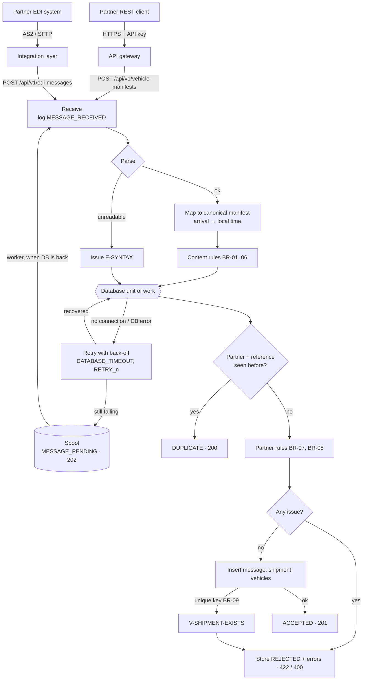

# Integration flow

One message from partner to database, for both channels, including the failure paths.
Design rationale: [06 · Integration design](../docs/06-integration-design.md).

## Where INC-001 happened

The path `INS → unique key BR-09` raised a database error inside the unit of work. In release
1.2.0 the connection was not returned to the pool on that error path. Five resends exhausted the
five connections; after that every message took the `RETRY → SPOOL` path.
See [INC-001](../incidents/INC-001-edi-processing-failure.md).
