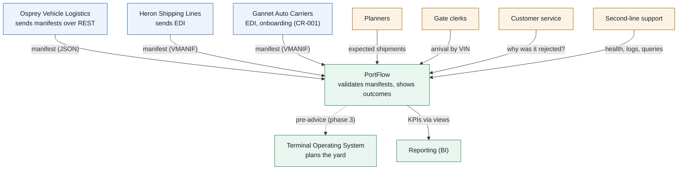

# System context

PortFlow and everything it talks to. Explanation per component:
[05 · Architecture](../docs/05-architecture.md).

| Actor / system | Relationship |
|---|---|
| Logistics partners | Announce vehicles; receive accept / reject feedback |
| Planners | See which shipments are expected and complete |
| Gate clerks | Register arrivals |
| Customer service | Explain rejections to partners |
| Second-line support | Monitor and troubleshoot |
| TOS | Will receive accepted pre-advice (IF-04, phase 3) |
| BI | Reads reporting views |
