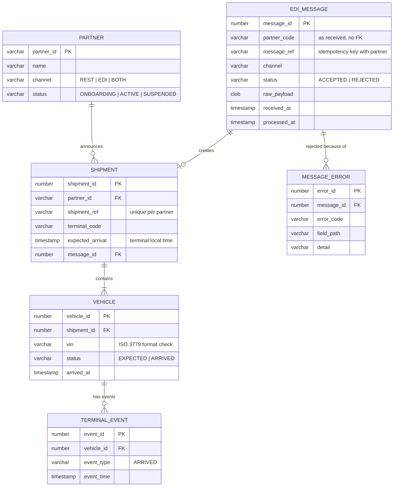

# Data model

Logical model of PortFlow. DDL: [schema.sql](schema.sql) (Oracle, validated in CI on Oracle
Database Free). The demo service uses the same tables on SQLite
([schema_sqlite.sql](../service/portflow/schema_sqlite.sql)).

## Design notes

| Choice | Reason |
|---|---|
| `EDI_MESSAGE.partner_code` has **no** foreign key | Messages from unknown partners must be stored too (as rejected), so support can see them |
| Idempotency via a function-based unique index | Oracle treats `(partner, NULL)` pairs as equal in a composite unique constraint; the `CASE` index skips rows without a reference |
| `UQ_SHIPMENT_PARTNER_REF` in the database | BR-09 holds even if two messages arrive at the same moment on two threads |
| `CK_VEHICLE_VIN` with `REGEXP_LIKE` | Last line of defence if a future code path skips validation |
| Indexes on every foreign key | Avoids full scans and table locks on the child when a parent row changes |
| Identity columns start at 1000 | Sample data uses ids below 1000 without colliding with generated ones |
| Reporting views | BI depends on the views, not on the tables ([11 · Reporting](../docs/11-reporting-and-kpis.md)) |
| Times as `TIMESTAMP` in terminal local time | Matches how operations plan; partners' offsets are converted on the way in |

## Volumes (sizing)

~2,500 vehicles and ~150 messages per day → ~55,000 messages and ~900,000 vehicle rows per
year. Raw payloads average ~6 KB, so ~330 MB per year before the 90-day purge. Small for Oracle;
the indexes on `received_at` matter more than storage.
