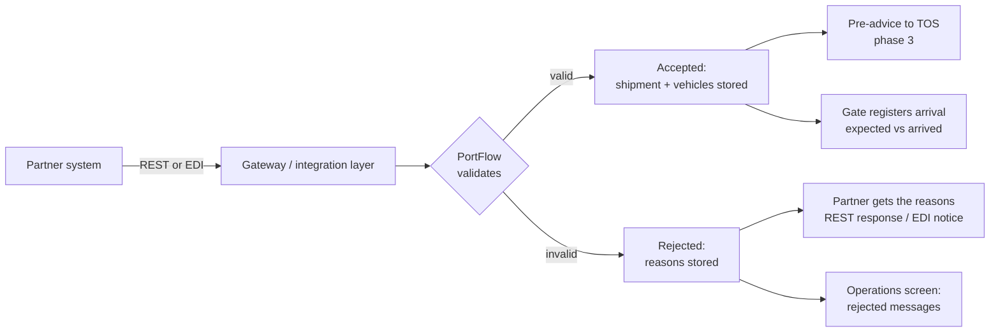
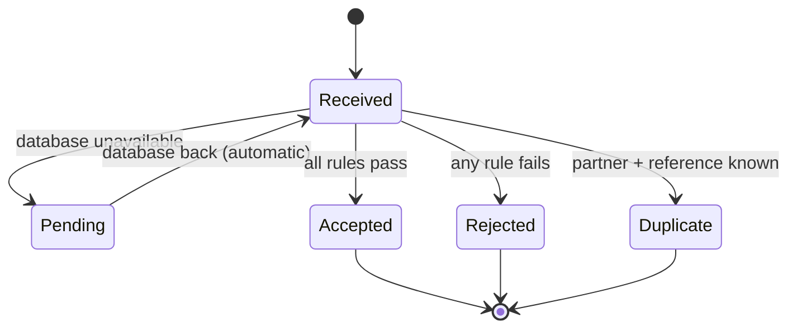

# 03 · Functional analysis

How the requirements in [02](02-business-requirements.md) behave, from the user's point of view.
Technical choices follow in [04 · Technical specification](04-technical-specification.md).

## Process: as-is and to-be

**As-is.** Partner sends a file → planning office opens it → retypes or imports it into the TOS
→ the vehicle arrives → the gate finds out whether the data was right.

**To-be.**

The partner hears about an error within seconds instead of hours, and the planning office
stops retyping.

## Message life cycle

Every inbound message ends in exactly one outcome:

| Outcome | Meaning | Stored? | Partner gets |
|---|---|---|---|
| ACCEPTED | All rules passed. Shipment and vehicles created. | Yes | HTTP 201 / positive EDI notice |
| REJECTED | At least one rule failed, or the payload is unreadable. Nothing created. | Yes, with every reason | HTTP 422 (400 for unreadable) / negative EDI notice with reasons |
| DUPLICATE | Same partner and message reference seen before. Ignored. | No new row | HTTP 200 with the original message id |
| PENDING | Valid or not, the database could not be reached. Kept in the spool. | Not yet, processed automatically later | HTTP 202 |

A rejected message is final. The partner corrects the data and sends a **new** message with a
new message reference. Because the rejected shipment was never created, the corrected one is not
blocked by BR-09.

Vehicle status: `EXPECTED` when the manifest is accepted, `ARRIVED` when the gate registers it.

## Rule evaluation order

1. **Read** the payload (JSON or EDI envelope). Unreadable → `E-SYNTAX`, stored as rejected.
2. **Map** to the canonical manifest; convert the arrival time to terminal local time.
3. **Content rules** that need no reference data: BR-01 to BR-06.
4. **Duplicate check** (BR-10). A duplicate stops here.
5. **Partner rules** BR-07, BR-08 against the partner register.
6. **Store.** The database enforces BR-09; a violation becomes `V-SHIPMENT-EXISTS`.

All failures of steps 3 and 5 are collected and returned together, so the partner can fix
everything in one go instead of one error per attempt.

## Screens

The demo implements one operations page (`/ops`). In production the same data would sit in the
TOS user interface or in a small Oracle APEX application
([11 · Reporting](11-reporting-and-kpis.md)).

| Area | Shows | For |
|---|---|---|
| Header | Health, version, free database connections, pending backlog | IT / second line |
| Last 24 hours | Accepted, rejected, pending, expected and arrived today, average processing time | Operations manager |
| Inbound messages | Filter on rejected / accepted / all; partner, reference, shipment, error codes | Customer service, planners |
| Message detail | Every rejection reason with field and explanation, raw payload | Customer service, second line |
| Expected shipments | Per shipment: expected arrival, arrived / announced | Planners, gate |

## Use case: customer service explains a rejection

1. A partner calls: "you did not receive our shipment HRN-2026-00131."
2. Customer service opens `/ops`, filter **Rejected**, finds the shipment.
3. The detail shows `V-ARRIVAL-DATE: date format 102 not accepted; use 203 or 303` and
   `V-VIN-FORMAT` on `vehicles[0].vin`, with the raw message.
4. Customer service tells the partner what to correct. No IT ticket is needed.

If the same reason shows up for every message of one partner, it is not a data error but a
change on the partner side. That is what happened in
[INC-002](../incidents/INC-002-partner-date-format-change.md).

## Use case: partner onboarding

Covered step by step in [12 · Partner onboarding](12-partner-onboarding.md) and worked out for
Gannet Auto Carriers in [CR-001](../changes/CR-001-new-logistics-partner.md).
