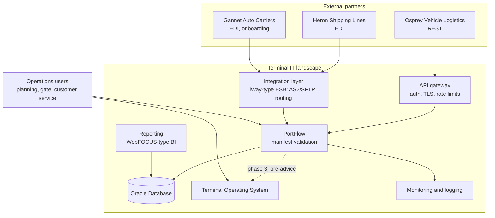
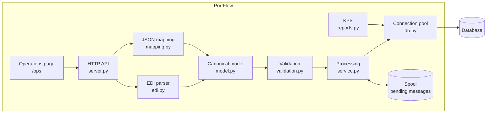

# 05 · Architecture

The views below follow the C4 idea: start with the context, then zoom in. Diagrams are Mermaid,
so they render on GitHub and change together with the text. More views:
[system context](../architecture/system-context.md) ·
[integration flow](../architecture/integration-flow.md) ·
[deployment](../architecture/deployment-view.md) ·
[data flow](../architecture/data-flow.md).

## Context

## Why each component exists

| Component | Responsibility | Why it is a separate piece |
|---|---|---|
| API gateway | Authenticates partners, terminates TLS, limits request rates | Security is the same for every API; it does not belong in each application |
| Integration layer | Receives EDI over AS2/SFTP, acknowledges at transport level, routes to PortFlow, sends EDI notices back | Partners differ in transport and envelope; the integration layer absorbs that so the application sees one HTTP call |
| PortFlow | Parses, maps to the canonical model, validates, stores, shows outcomes | Business rules live in one place, for both channels |
| Oracle Database | Stores messages, errors, shipments, vehicles, events; reporting views | Shared, backed-up, transactional store the terminal already operates |
| TOS | Plans the yard from accepted pre-advice | System of record for the yard; PortFlow feeds it, it does not replace it |
| BI / reporting | KPIs per partner and per day | Managers read reports, not application screens |
| Monitoring | Health checks, log events, alerts | Second-line support needs to see a problem before a partner calls |

## Inside PortFlow

The pattern is **parse → canonical model → validate → store**. A new partner format means a new
parser or mapping. Validation and storage stay the same
([D-001](../project-management/decision-log.md)).

## Target landscape and demo

The repository runs without infrastructure. The table shows what each demo piece stands for.

| Concern | Target landscape | This repository |
|---|---|---|
| Runtime | Java EE / Jakarta EE WAR on JBoss EAP | Python standard library HTTP server |
| Host | IBM Power server running AIX (or Linux) | Any machine with Python 3.12 |
| Database | Oracle Database 19c | SQLite with the same tables; the Oracle DDL is validated in CI |
| Connection pool | JBoss datasource (`max-pool-size`, `blocking-timeout-wait-millis`) | `ConnectionPool` in `db.py`, same behaviour |
| EDI transport | Integration layer (iWay-type) over AS2/SFTP | HTTP `POST /api/v1/edi-messages` |
| Spool | JMS queue or a database inbox table | Directory with atomically written files |
| Operations UI | TOS screen or Oracle APEX application | `/ops` page |
| Reporting | WebFOCUS-type reports on Oracle views | `/api/v1/reports/kpis` and the views in `schema.sql` |

Python was chosen for the demo so anyone can run it in one command; the contract (API, data
model, log events, behaviour under failure) is what carries over to a Java implementation.
How the target stack fits together is explained in
[10 · Infrastructure and application server](10-infrastructure-and-application-server.md).

## Quality attributes and how they are met

| Attribute | Mechanism |
|---|---|
| No lost messages (NFR-04) | Spool with atomic writes, automatic drain in arrival order |
| Idempotency | Unique key on partner + message reference |
| Data integrity | Database constraints for BR-02 and BR-09, not only application code |
| Gentle on the database (NFR-09) | Bounded pool, short transactions, connections always returned |
| Observability (NFR-07) | `/health` with pool and backlog, one log event per step |
| Changeability (NFR-08) | Canonical model; partner settings are data (`PARTNER` table) |
