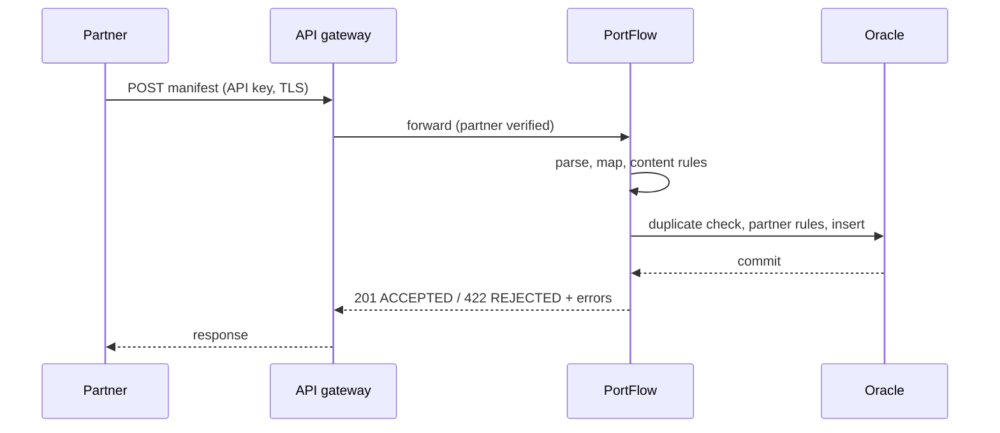

# 06 · Integration design

Two channels, one canonical model. Field-level details are in the
[mapping specification](../integrations/mapping-specification.md); every rejection code is in
[error scenarios](../integrations/error-scenarios.md).

## Channel 1: REST (synchronous)

```
POST /api/v1/vehicle-manifests
Content-Type: application/json
```

```json
{
  "partnerId": "OSP",
  "messageRef": "OSP-MSG-88412",
  "shipmentId": "OSP-2026-03317",
  "expectedArrival": "2026-10-08T09:30:00+02:00",
  "terminalCode": "BEZEE",
  "vehicles": [
    { "vin": "YV1XZK9V1R2000731", "make": "Volvo", "model": "EX30" }
  ]
}
```

Full example: [sample-vehicle-import.json](../integrations/sample-vehicle-import.json).
Contract: [openapi.yaml](../integrations/openapi.yaml).

The partner gets the outcome in the same call:

| HTTP | Body `status` | Partner action |
|---|---|---|
| 201 | `ACCEPTED` | None |
| 200 | `DUPLICATE` | None; `messageId` points to the original |
| 202 | `PENDING` | None; processed automatically. Do not resend with a new reference. |
| 400 | `REJECTED` (`E-SYNTAX`) | Fix the JSON |
| 422 | `REJECTED` | Fix the listed fields, send again with a **new** `messageRef` |



## Channel 2: EDI (asynchronous for the partner)

Partners that already exchange EDI keep doing so. The integration layer receives the
interchange, acknowledges it at transport level, and posts it unchanged to PortFlow:

```
Partner EDI message
        ↓  AS2 / SFTP
Integration layer (transport ack, routing per sender id)
        ↓  POST /api/v1/edi-messages (text/plain)
PortFlow parser → canonical manifest → validation → database
        ↓
Outcome back to the integration layer → EDI notice to the partner
```

Message: `VMANIF`, an EDIFACT-syntax vehicle manifest defined for this case
([sample](../integrations/sample-edi-message.edi)):

```
UNA:+.? '
UNB+UNOC:3+HRN:ZZZ+PORTFLOW:ZZZ+261007:0941+000125'
UNH+1+VMANIF:1:0:PF'
BGM+VMN+HRN-2026-00125+9'
DTM+132:202610081400:203'
LOC+11+BEZEE'
GID+1'
PIA+5+WVWZZZE1ZPP012345:VIN'
IMD+F++:::Volkswagen:ID.4'
...
UNT+19+1'
UNZ+1+000125'
```

What the parser checks before any business rule, because a real EDI flow fails on these first:

- the envelope: `UNB` first, `UNZ` last, same control reference;
- exactly one `UNH`…`UNT` message of type `VMANIF`;
- the `UNT` segment count matches the real number of segments (detects truncated files);
- the release character `?` so separators can appear inside data (`?+`, `?:`, `?'`).

A real implementation would use a standard message (for vehicles, typically a DESADV- or
IFTMIN-based implementation guide agreed per partner). The parsing concerns are the same.

## Canonical model

| Canonical field | REST field | EDI source |
|---|---|---|
| `partner_id` | `partnerId` | `UNB` sender id |
| `message_ref` | `messageRef` | `UNB` interchange control reference |
| `shipment_ref` | `shipmentId` | `BGM` document number |
| `expected_arrival` | `expectedArrival` (ISO 8601) | `DTM+132` (format 203 or 303) |
| `terminal_code` | `terminalCode` | `LOC+11` |
| `vehicles[].vin` | `vehicles[].vin` | `PIA+5+…:VIN` after each `GID` |
| `vehicles[].make` / `model` | `make` / `model` | `IMD` descriptions |

## Cross-cutting rules

**Idempotency.** `(partner_id, message_ref)` is unique. A partner (or the integration layer) may
resend safely after a timeout; the second copy is answered as `DUPLICATE`.

**Whole-manifest rejection.** A manifest is accepted or rejected as a whole
([D-002](../project-management/decision-log.md)). Partial acceptance would create shipments that
are missing vehicles nobody knows about.

**Time zones.** The terminal plans in local time. REST may send an offset; EDI uses format 203
(local) or 303 (with UTC offset, added for Gannet in [CR-001](../changes/CR-001-new-logistics-partner.md)).
Everything is stored as Europe/Brussels local time, daylight saving included.

**Database outage.** The partner is never asked to resend because of a terminal problem: the
message waits in the spool and is processed when the database is back (FR-009).

**Partner feedback for EDI.** For REST the HTTP response is the feedback. For EDI the integration
layer turns the outcome into a notice to the partner (in practice an APERAK- or CONTRL-type
message, or e-mail for small partners). That outbound step is outside this repository.

## Where integrations go wrong, and what covers it

| Risk | Covered by |
|---|---|
| Partner changes its software and the format shifts | Strict validation with clear codes; rejection-rate alert per partner ([INC-002](../incidents/INC-002-partner-date-format-change.md)) |
| Partner resends a whole batch | Idempotency + BR-09 ([INC-001](../incidents/INC-001-edi-processing-failure.md) started this way) |
| Truncated file over SFTP | `UNT` count and `UNZ` control reference checks |
| Database briefly unavailable | Retry, spool, automatic drain |
| New partner with a slightly different dialect | Mapping review in onboarding ([12](12-partner-onboarding.md)) |

## Actual terminal events after announcement

The [gate-to-yard-to-departure contract](../integrations/terminal-event-contract.md) extends the
case analysis with actual events, holds, replay/ordering rules and reconciliation ownership.
A standalone executable reference and synthetic fixture verify the proposed rules. This is
separate from the manifest API above; no additional REST endpoint is implied.
