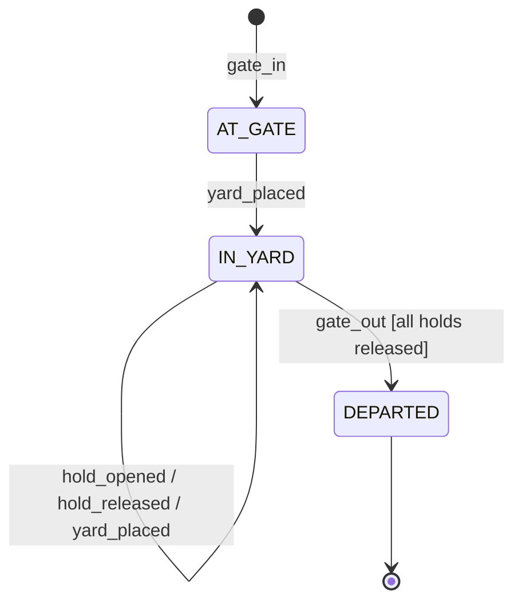

# Terminal events · gate → yard → departure

**Wire schema 1 · synthetic reference implementation · 22 October 2026.**

The existing REST/EDI service accepts vehicle announcements. This separate reference model
specifies what happens **after a vehicle arrives**. It is executable without a server, external
packages or credentials; it adds no event-ingestion endpoint to the announcement API.

[Run the scenario](../scripts/replay-terminal-events.py) · [Input fixture](sample-terminal-events.json) ·
[Expected executable output](../testing/terminal-event-evidence.json) ·
[Acceptance tests](../service/tests/test_terminal_events.py) ·
[Tracked delivery](https://github.com/phlppgdfry/portflow-terminal-case-study/issues/1)

From the repository root, using Python 3.12+:

```bash
python3 scripts/replay-terminal-events.py
```

Expected: eight deliveries; five applied events, one blocked departure, one harmless replay and
one ID conflict. The final visit is `DEPARTED` with no open holds.

## Scenario and business rules



Holds may also open/release at the gate. Yard movement preserves every open hold. The fixture
attempts departure while a customs hold is open; the rejection leaves the visit unchanged.
Only after release of that exact hold can the vehicle depart.

| Time, UTC | Source event | Outcome | Business meaning |
| --- | --- | --- | --- |
| 08:00 | `gate-001` · `gate_in` | applied | Establish vehicle, source and visit identity |
| 08:10 | `yard-001` · `yard_placed` | applied | Vehicle placed at `YARD-A-12` |
| 08:15 | `hold-001` · `hold_opened` | applied | Customs hold `CUSTOMS-001` blocks departure |
| 08:20 | `blocked-out-001` · `gate_out` | HOLD_BLOCKED | No departure is recorded |
| 08:30 | `release-001` · `hold_released` | applied | Release that hold; other holds would still block |
| 08:45 | `out-001` · `gate_out` | applied | Complete the visit |
| Retry | identical `out-001` | replayed | Return the original result; do not apply again |
| Conflict | changed `out-001` | ID_CONFLICT | Do not overwrite accepted evidence |

## Envelope and ownership

The fixture wraps each producer event in a delivery with an adapter-owned `receivedAt` and an
`expected` test outcome. Only the inner `event` belongs to the source contract.

| Field | Rule |
| --- | --- |
| `schemaVersion` | Integer `1`; independent of service/package version |
| `source` | Stable source name, permitted by trusted adapter configuration for this terminal |
| `eventId` | Stable source event ID, unique within `(terminalId, source)` |
| `terminalId` | Configured terminal, such as fictional `BEZEE` |
| `visitId` | One terminal visit; a returning vehicle needs a new ID |
| `vin` | Canonical 17-character VIN; immutable during a visit |
| `type` | `gate_in`, `yard_placed`, `hold_opened`, `hold_released` or `gate_out` |
| `occurredAt` | Actual source occurrence, never a forecast |
| `observedAt` | When the source observed the event |
| `yardLocation` | Required only for `yard_placed`; descriptive location, not a validated yard directory |
| `holdId` | Required only for hold events; release must reference an open hold |

Strings are nonblank, at most 128 characters; unknown or inappropriate fields are rejected.
Timestamps require seconds and explicit `Z` or `±HH:mm`; up to six fractional digits are allowed.
Impossible dates and offsets are rejected. Comparisons use absolute instants across offsets.
Require `occurredAt <= observedAt <= receivedAt`. A real adapter records receipt itself, monitors
clock skew and investigates bad source clocks instead of rewriting timestamps.

Unlike the announcement service's Brussels-local planning model, these actual events retain
explicit offsets. This avoids guessing the instant during a daylight-saving transition.

One visit has one owning source and VIN. This deliberately small model does not merge evidence
from multiple source systems. An integration design must establish source precedence before
adding that behavior. It does not share the Shipment Desk envelope or imply cross-project wire
compatibility: both scenarios document their own boundaries.

## Retry, ordering and reconciliation

- **Identical accepted ID and payload:** replay the stored original result, including original
  receipt time and state snapshot. The current visit stays unchanged; read current state separately.
- **Accepted ID with changed payload:** `ID_CONFLICT`, even after departure. JSON object key order
  is immaterial; timestamp spelling and every field value remain part of the payload identity.
- **New event older than the last accepted occurrence:** `OUT_OF_ORDER`; do not silently reorder
  or discard it. Equal occurrence times are permitted and follow delivery order.
- **Rejected event:** no ledger/state mutation and no reserved event ID. A corrected event can be
  submitted again. Corrections to already accepted evidence require explicit reconciliation;
  this prototype provides no overwrite/correction operation.
- **Failure before acknowledgement:** resend the same ID and exact payload. A durable production
  adapter must atomically store event identity, result and visit state before acknowledging.

| Problem | Reference outcome | Proposed reconciliation owner and action |
| --- | --- | --- |
| Missing gate/yard event | GATE_REQUIRED / YARD_REQUIRED | Integration team retrieves missing evidence; operations confirms actual movement |
| Late new event | OUT_OF_ORDER | Integration team quarantines it; operations approves an explicit correction plan |
| Changed accepted payload | ID_CONFLICT | Source partner and application owner compare original evidence; never silently replace |
| Wrong VIN/source for visit | VISIT_IDENTITY | Source owner verifies visit mapping; application owner approves repair |
| Unknown terminal/source | SOURCE | Integration/security owners verify routing and trusted source configuration |
| Bad timestamp/clock order | TIMESTAMP / CLOCK_ORDER | Source owner checks clock/configuration and resubmits corrected, unaccepted evidence |
| Open hold / unknown release | HOLD_BLOCKED / HOLD_UNKNOWN | Operations obtains valid clearance evidence; IT cannot invent clearance |

These roles follow the case [RACI](../project-management/RACI.md). The quarantine queue,
alerts and reconciliation interface are design responsibilities, not implemented services.

## Traceability and evidence

| Requirement | Executable check |
| --- | --- |
| TE-01 gate before yard, yard before departure | `test_gate_required_before_yard`, `test_yard_required_before_out` |
| TE-02 all holds released; matching hold identity | `test_hold_blocks_until_matching_release`, `test_every_hold_must_be_released` |
| TE-03 scoped identity and exact replay | `test_replay_returns_original_without_rewinding`, `test_terminal_scope_independent` |
| TE-04 stable visit identity and immutable departure | `test_visit_source_and_vehicle_stable`, `test_second_gate_requires_new_visit`, `test_departed_visit_immutable` |
| TE-05 explicit times, late evidence and schema validation | `test_clocks_and_offsets`, `test_late_new_evidence_needs_reconciliation`, `test_schema_shape_vin_and_identity` |
| TE-06 no partial changes or caller mutation | Every rejection asserts unchanged state; `test_returned_state_detached` |
| TE-07 reproducible gate-to-yard-to-departure outcome | `test_full_fixture` and standalone replay command |

The [implementation](../service/portflow/terminal_events.py) stores state in memory. It is
single-process, sequential and loses state on restart. Source allowlisting is configuration,
not authentication. Durable storage, concurrent delivery, signed source identity, real TOS
adapters and authorized clearance require separate implementation. No physical cargo release
or production integration is performed by this example.
